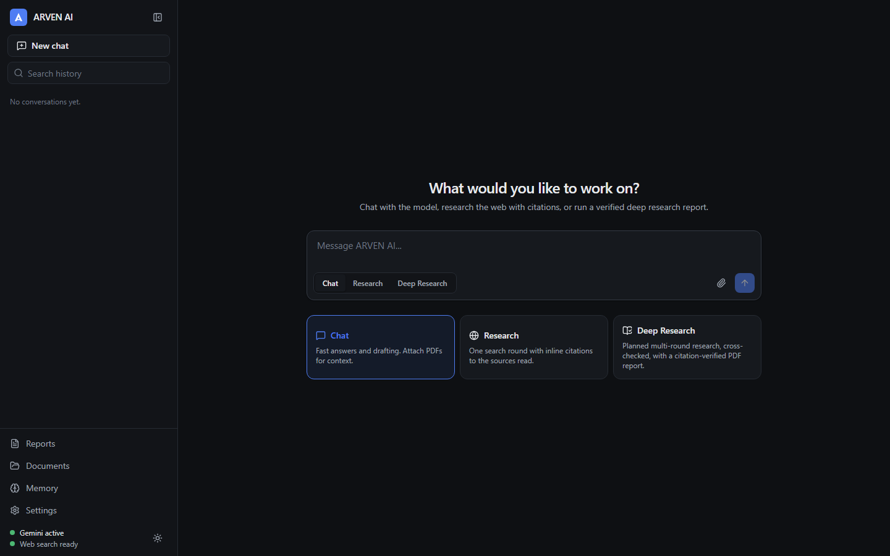

# ARVEN AI

**Live:** https://arven-research.netlify.app/

A local AI research workspace with three modes:

- **Chat**: streaming conversation with optional PDF context. No web access.
- **Research**: one search round, up to 8 sources read, answer with numbered citations that map to real retrieved sources.
- **Deep Research**: plan (optionally reviewed by you), multiple search rounds with gap and conflict follow-ups, source reading, per-subquestion analysis, a streamed draft, and a verifier pass that removes uncited or unsupported claims. Produces a report with a references section and PDF export.

Gemini is the primary model. When Gemini fails (quota, rate limit, auth, outage, bad output) the router falls back to NVIDIA automatically, and the UI shows which provider answered. Search uses Tavily with a best-effort DuckDuckGo fallback.

Everything runs on your machine: FastAPI on `127.0.0.1:8000`, Vite on `127.0.0.1:5173`, SQLite in `data/`. API keys stay in `.env` on the backend and are never sent to the browser.



## Requirements

- Python 3.12+ (developed on 3.13)
- Node.js 20.19+ (developed with Node 24)
- Keys: `GEMINI_API_KEY` and/or `NVIDIA_API_KEY`; `TAVILY_API_KEY` for reliable search

## Setup

### Windows (PowerShell)

```powershell
cd backend
py -3.13 -m venv .venv
.\.venv\Scripts\python.exe -m pip install -r requirements.txt -r requirements-dev.txt
cd ..\frontend
npm install
cd ..
if (-not (Test-Path .env)) { Copy-Item .env.example .env }
notepad .env
```

### Linux / macOS

```bash
cd backend
python3 -m venv .venv
.venv/bin/pip install -r requirements.txt -r requirements-dev.txt
cd ../frontend
npm install
cd ..
[ -f .env ] || cp .env.example .env
${EDITOR:-nano} .env
```

Fill in `GEMINI_API_KEY`, `NVIDIA_API_KEY` and `TAVILY_API_KEY` in `.env`. Never commit `.env` (it is gitignored).

## Run

Two terminals.

### Windows (PowerShell)

```powershell
# Terminal 1
cd backend
.\.venv\Scripts\python.exe -m app
```

```powershell
# Terminal 2
cd frontend
npm run dev
```

### Linux / macOS

```bash
cd backend && .venv/bin/python -m app
```

```bash
cd frontend && npm run dev
```

Open http://127.0.0.1:5173. Open **Settings** to see provider status and run a connection test for each provider.

## Tests

All automated tests use scripted fake providers and fake search. They make no network calls and use no keys.

### Windows (PowerShell)

```powershell
cd backend
.\.venv\Scripts\python.exe -m pytest -q
.\.venv\Scripts\python.exe -m ruff check .
.\.venv\Scripts\python.exe -m mypy app
cd ..\frontend
npm test
npm run typecheck
npx playwright install chromium   # first time only
npm run e2e
```

### Linux / macOS

```bash
cd backend
.venv/bin/python -m pytest -q
.venv/bin/python -m ruff check .
.venv/bin/python -m mypy app
cd ../frontend
npm test
npm run typecheck
npx playwright install chromium   # first time only
npm run e2e
```

`npm run e2e` starts the real backend app wired to fakes (`backend/tests/e2e_server.py`, port 8001) and a Vite dev server on port 5174. Both ports must be free. Screenshots are written to `docs/screenshots/`.

## Configuration

All settings live in `.env` (see `.env.example` for comments).

| Variable | Default | Purpose |
| --- | --- | --- |
| `GEMINI_API_KEY` | empty | Primary model provider |
| `GEMINI_MODEL` | empty (uses `gemini-3.5-flash-lite`) | Gemini model id |
| `NVIDIA_API_KEY` | empty | Fallback model provider |
| `NVIDIA_MODEL` | `nvidia/nemotron-3.5-super-vl-120b-a12b` | NVIDIA model id |
| `NVIDIA_BASE_URL` | `https://integrate.api.nvidia.com/v1` | OpenAI-compatible endpoint |
| `TAVILY_API_KEY` | empty | Web search |
| `SEARCH_PROVIDER` | `tavily` | Primary search provider |
| `ENABLE_DUCKDUCKGO_FALLBACK` | `true` | Unofficial fallback search |
| `DATABASE_URL` | `sqlite:///./data/arven_ai.db` | Relative to repo root |
| `BACKEND_HOST` / `BACKEND_PORT` | `127.0.0.1` / `8000` | Non-local hosts are refused |
| `FRONTEND_ORIGIN` | `http://localhost:5173` | CORS allowlist (127.0.0.1 variant added automatically) |
| `ALLOWED_HOSTS` | `127.0.0.1,localhost` | Host headers the API accepts (DNS-rebinding protection) |
| `ACCESS_PASSWORD` | empty | Login password; required when deployed, empty means no login |
| `MAX_SEARCH_ROUNDS` | `2` | Deep research rounds |
| `MAX_UNIQUE_SOURCES` | `20` | Source cap per job |
| `MAX_CONCURRENT_REQUESTS` | `4` | Parallel fetches |
| `REQUEST_TIMEOUT_SECONDS` | `20` | Per-request timeout |
| `MAX_REPORT_WORDS` | `2500` | Report length target |
| `MAX_RETRY_ATTEMPTS` | `2` | Retries per provider before fallback |
| `JOB_TIMEOUT_SECONDS` | `900` | Deep research hard limit |
| `PROVIDER_COOLDOWN_SECONDS` | `60` | Circuit breaker cooldown |
| `PROVIDER_QUOTA_COOLDOWN_SECONDS` | `1800` | Cooldown after a daily-quota error |
| `MAX_UPLOAD_MB` | `20` | PDF upload limit |

The frontend dev server proxies `/api` to `http://127.0.0.1:8000`. Override with `ARVEN_BACKEND_URL`.

## Troubleshooting

- **"No model provider is configured"**: add `GEMINI_API_KEY` or `NVIDIA_API_KEY` to `.env` and restart the backend. The backend reads `.env` only at startup.
- **Gemini quota or rate limit**: the router switches to NVIDIA for the cooldown period. Settings shows each provider's last error and roughly when it will be retried.
- **Invalid key (401/403)**: the provider is marked "needs credentials" in Settings. Fix the key and restart.
- **Model not found**: check `GEMINI_MODEL` / `NVIDIA_MODEL` against the provider's model list.
- **Research says search is unavailable**: set `TAVILY_API_KEY`. DuckDuckGo is an unofficial fallback and is often rate-limited.
- **A source shows "unreadable"**: the page blocked fetching, was not HTML/PDF/text, was larger than 3 MB, or resolved to a private address (blocked on purpose).
- **Scanned PDFs**: uploaded but marked "no text layer" and not used as context. OCR is not supported.
- **Deep research job shows "interrupted"**: the backend restarted while it was running. Jobs do not survive restarts; start it again.
- **Port in use**: change `BACKEND_PORT` (and `ARVEN_BACKEND_URL` for the frontend), or stop the other process.

## Deploy (Netlify + Render)

Netlify serves the static frontend. The FastAPI backend needs a long-running Python server (Deep Research streams for minutes), so it runs on Render. A deployed backend requires `ACCESS_PASSWORD`; the app shows a login screen and refuses to start on a public address without it.

1. **Backend on Render.** In Render: New > Blueprint > pick this GitHub repo. Render reads `render.yaml` and asks for:
   - `ACCESS_PASSWORD`: a password you choose, at least 12 characters (`SESSION_SECRET` is generated automatically)
   - `FRONTEND_ORIGIN`: your Netlify URL (fill in after step 2, then redeploy), e.g. `https://arven-ai.netlify.app`
   - `GEMINI_API_KEY`, `NVIDIA_API_KEY`, `TAVILY_API_KEY`

   Note the service URL, e.g. `https://arven-api.onrender.com`. Check `https://<service>/api/health` returns `{"status":"ok"}`.
2. **Frontend on Netlify.** In Netlify: Add new project > Import from GitHub > pick this repo. `netlify.toml` sets the build. Before deploying, add the environment variable `VITE_API_BASE` = the Render URL (no trailing slash).
3. Set `FRONTEND_ORIGIN` on Render to the Netlify URL and redeploy the backend.
4. Open the Netlify URL and unlock with `ACCESS_PASSWORD`.

Notes:
- Keys live only in Render's environment settings, never in the frontend build.
- On Render's free plan the service sleeps when idle (the first request takes a while) and the disk is not persistent, so chat history, uploads and reports are lost on restart or redeploy. To keep them, use a paid instance with a persistent disk and point `DATA_DIR` and `DATABASE_URL` (absolute `sqlite:////path/arven_ai.db`) at it.
- Changing `ACCESS_PASSWORD` signs out every browser.

## Project layout

```
backend/
  app/
    api/             FastAPI routers (chat SSE, research jobs, documents, reports, settings)
    db/              SQLAlchemy models and session
    services/
      providers/     Gemini, NVIDIA, circuit breaker, fallback router
      search/        Tavily, DuckDuckGo, SSRF-safe fetching, dedupe
      research/      planner, analyst, writer, verifier, job manager, orchestrator
      documents/     PDF extraction, chunking, BM25 retrieval
      reports/       ReportLab PDF export
  tests/             pytest suites and the E2E fake server
frontend/
  src/               React app (features/chat, research, reports, documents, settings)
  tests/unit/        Vitest
  tests/e2e/         Playwright
docs/screenshots/    UI screenshots from the E2E run
data/                SQLite DB, uploads (gitignored)
```

## Security notes

- Keys are read from `.env` server-side only, redacted from logs, and never returned by the API.
- The backend binds to localhost only; CORS allows only the configured frontend origin.
- Fetched URLs are DNS-resolved and blocked if they point to private, loopback, link-local or metadata addresses, re-checked on every redirect.
- Retrieved web and PDF content is wrapped as untrusted data in prompts; instructions inside it are not followed.
- Markdown is rendered with `rehype-sanitize`.

## Limitations

- No OCR for scanned PDFs.
- DuckDuckGo fallback is unofficial and best-effort.
- Running deep research jobs do not survive a backend restart.
- Single user. Locally there is no login; deployed instances use one shared `ACCESS_PASSWORD`.
